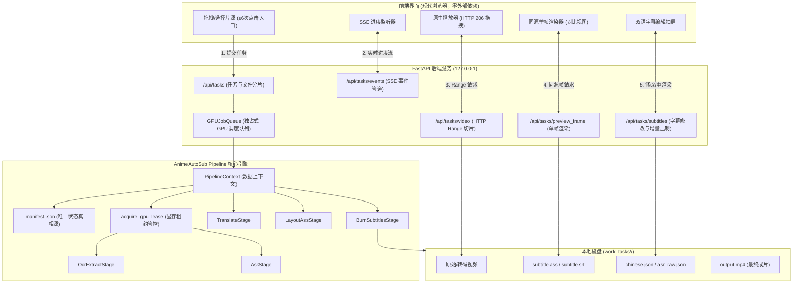

# ADR-001: AnimeAutoSub WebUI 系统架构与技术选型决策记录

- **状态**: 提议中 / 待 PO 确认 (Proposed for Review)
- **日期**: 2026-11-01
- **决策者**: AnimeAutoSub 核心开发团队
- **对应里程碑**: 主线第 3 节 · W 阶段 (WebUI)

---

## 1. 背景与驱动因素 (Context)

AnimeAutoSub 已在 S 阶段完成流水线模块化解耦（`core/pipeline.py`、`core/stage.py`、`core/gpu_lease.py`）与语言插件化（ja/ko），并通过三元组哈希校验实现了 Stage 级增量缓存与秒级跳过。在 K1 阶段亦完成了韩语双链路打通与单测固化。

当前系统的主要使用方式仍为 CLI 终端脚本调用。为了让普通翻译者与质检人员（PO）能够高效操作、在线审阅遮罩与译文、快速微调字幕并即时导出成片，必须构建一套直观、坚固且无额外环境负担的本地 Web 界面。

### 核心纪律与边界限制 (Non-Negotiable Constraints)
根据业务规范，本项目坚决遵守以下纪律，绝对不做过度设计：
1. **不做**：账号权限系统、多用户隔离、云端数据同步、Docker 容器化、CDN 部署。
2. **唯一瓶颈是 GPU**：单机 RTX 4060（8GB 显存），队列的价值是**绝对防止两个任务并发抢占显存触发 OOM**，而不是追求并发吞吐。
3. **真相在文件系统**：`work_<task_id>/manifest.json` 是流水线状态的唯一事实来源；内存/轻量数据库仅作为可随时重建的索引缓存。
4. **预览必须与最终压制同源**：由服务端单帧渲染输出，前端绝对不自算排版和字体度量。
5. **视频流必须支持 HTTP Range**：保证 HTML5 播放器能随意平滑拖拽进度条。
6. **六种异常必须有恢复路径**：进程被杀、任务卡死、取消未释放、SSE 断开、上传中断、磁盘空间满。

---

## 2. 核心架构决策 (Decisions)

### 决策 1：后端服务选型 —— FastAPI + Uvicorn
- **决定**：选用 **FastAPI** 作为 Web 服务框架，以 **Uvicorn** 作为 ASGI 服务器。
- **理由**：
  1. **同进程与生态复用**：直接运行在现有的 `.\venv\Scripts\python.exe` 虚拟环境中，无缝调用 `core.pipeline`、`faster-whisper`、`RapidOCR` 与 `GPULease`，避免跨进程 IPC 协议序列化开销。
  2. **原生异步与高性能传输**：FastAPI 原生支持 `asyncio` 与流式响应，处理基于 HTTP Range 的大视频切片传输和 SSE（Server-Sent Events）日志流极其简洁轻量。
  3. **严格的数据契约**：基于 Pydantic 自动化类型约束与数据序列化，天生具备 API 文档（Swagger/OpenAPI）支持。
- **淘汰候选**：
  - *Flask*：异步生态与流式传输支持较弱，需额外扩展依赖。
  - *Electron / Tauri 混合桌面*：引入庞大的 Node.js/Chromium 运行时（额外增加 200MB~500MB 内存占用），安装打包复杂，易引发与本地 CUDA/C++ DLL 的路径冲突。

### 决策 2：前端架构选型 —— 现代原生 ES Modules (零 Node.js 构建工具)
- **决定**：采用**原生现代浏览器标准技术栈（HTML5 + 原生 ES Modules + 现代 CSS Grid/Flex）**，由 FastAPI 静态文件目录直接托管。
- **理由**：
  1. **零环境负担**：用户与开发者只需 Python 虚拟环境，**无需安装 Node.js、npm 或配置 Vite/Webpack 构建流水线**，杜绝 `node_modules` 膨胀与版本漂移。
  2. **现代浏览器支持完备**：现代 Chromium（Edge/Chrome）原生支持 ES6 模块导入、Web Components、CSS Variables、Fetch 与 EventSource。
  3. **修改即生效**：前端代码直接存放在 `web/static/`，修改代码直接刷新浏览器即可生效，极大利于排查与维护。
- **淘汰候选**：
  - *Vue3 / React 单页工程 (Vite 构建)*：引入多余的编译打包阶段，对单机本地离线工具而言徒增工程复杂度。

### 决策 3：状态管理与持久化 —— "文件系统即真理，manifest.json 唯一事实源"
- **决定**：
  1. 每个任务创建独立的目录 `work_tasks/<task_id>/`。
  2. 流水线的所有阶段状态、参数指纹、产物哈希与日志，统一持久化在 `work_tasks/<task_id>/manifest.json` 中。
  3. 内存中仅维护一个轻量任务索引表（基于 Python 字典或内存 SQLite），服务冷启动时自动扫描 `work_tasks/` 目录重建索引。若服务崩溃或被 Kill，重启后内存数据丢失时通过文件系统 100% 还原，零数据损坏风险。

### 决策 4：预览与压制同源方案 —— 服务端同源单帧渲染
- **决定**：前端绝对不通过 Canvas 或 CSS 模拟字幕渲染，所有字幕预览帧**均由后端通过 FFmpeg + libass 滤镜在服务端单帧渲染生成**。
- **实现机制**：
  - 用户在前端播放器点击某个时间戳 $T$ 时，发起请求：`GET /api/tasks/{task_id}/preview_frame?timestamp=T`。
  - 服务端精准 Seek 渲染 (M1 规范)：
    ```bash
    ffmpeg -y -i input.mp4 -ss {T} -vf "ass='{task_dir_abs}/subtitle.ass'" -vframes 1 -f image2 -q:v 2 pipe:1
    ```
  - **多级缓存与节流**: 服务端按 `sha256(ass) + round(T, 2)` 做内存 LRU 缓存（命中 <5ms）；前端在拖动时间轴时施加 $\ge 150\text{ ms}$ 节流并中止上一请求。
  - 直接输出单帧 JPEG 流至前端 `` 标签。
- **价值**：
  - 彻底杜绝前端字幕与最终成片在字体渲染引擎、描边宽度、字间距、折行断句上的微小差异（如 1~2px 坐标偏移导致遮罩露边），确保“所见即最终成片”。

### 决策 5：流媒体传输 —— 标准 HTTP 206 Partial Content (Range)
- **决定**：流媒体端点 `/api/tasks/{task_id}/video` 实现标准 HTTP Range 协议。
- **机制**：
  - 读取请求头 `Range: bytes=start-end`；
  - 响应 `HTTP 206 Partial Content`，返回 `Content-Range: bytes start-end/total`；
  - 支撑前端 `<video>` 原生进度条任意随意跳转与平滑预加载。

### 决策 6：GPU 调度模型 —— 严格单 Worker 独占租约队列
- **决定**：设计 `GPUJobQueue`，系统内全局仅允许**至多 1 个任务持有 GPU 租约并执行推理**。
- **机制**：
  - 任务提交后先进入 CPU 预处理阶段（如元信息探测、音频抽取）；
  - 遇到标记 `requires_gpu=True` 的阶段（ASR / OCR），必须向全局队列申请租约，排队等待；
  - 推理完成或遇到异常时，强制在 `finally` 块中归还租约，并通知下一个任务；
  - 翻译阶段采用 Ollama（CPU/GPU 动态卸载）并复用连接池，与 ASR/OCR 串行错开，彻底避免显存超限。

---

## 3. 六大生产异常全面恢复路径 (Fault Recovery Architecture)

| 异常类型 | 潜在诱因 | 系统恢复路径与设计对策 |
| :--- | :--- | :--- |
| **1. 进程被杀 (Kill Worker)** | 用户关闭终端、系统注销、OOM 强制终止 | **断点增量续跑**：重启 Web 服务后，自动读取 `manifest.json`。因为各 Stage 均有三元组校验（参数指纹/上游哈希/产物存在），已完成阶段 100% 秒级跳过，Worker 从中断的阶段继续向下执行，零重复浪费。 |
| **2. 任务卡死 (Hang)** | 模型推理死锁、外部进程未响应 | **心跳守卫与硬超时**：Worker 维护 Stage 级心跳时间戳（如 OCR 阶段若 3 分钟未处理任何帧）。一旦超时，自动标记任务为 `FAILED_TIMEOUT`，强制终止子进程并释放 GPU 租约。 |
| **3. 取消未释放 (Resource Leak)** | 用户中途点击“取消”，但显存未退回 | **安全注销与显存回收钩子**：前端发起 `POST /cancel` 时，触发该任务的 `cancel_token.cancel()`；Stage 内部轮询该 Token 退出；`gpu_lease` 保证在 `finally` 块中释放锁，并向 Ollama 发送 `keep_alive: 0` 强制释放显存。 |
| **4. SSE 断开 (Network Drop)** | 浏览器网络抖动、页面刷新、休眠唤醒 | **断线自动重连与回放**：后端内存环形缓冲区保留最近 200 条日志事件；前端 `EventSource` 断开时自动发起带 `Last-Event-ID` 的重连，后端补发断开期间事件，界面无感复原。 |
| **5. 上传中断 (Upload Interrupted)** | 大文件上传到一半网络断开 | **分片上传与校验**：文件按 5MB 分片上传至临时目录 `work_tasks/<task_id>/chunks/`，每次上传携带分片序号与 MD5；网络恢复后继续上传缺失分片，全部到位后后端无损合并，避免重新上传数十 GB 母片。 |
| **6. 磁盘空间满 (Disk Full)** | 大量临时帧与压制文件耗尽磁盘 | **预检拦截与自动清理**：任务启动及各 Stage 执行前，调用 `shutil.disk_usage` 检测工作盘剩余空间（门禁线：2.0 GB）。空间不足时主动拒绝执行并返回明确告警；提供一键清理已完成任务临时产物（如抽取的 wav、中间帧）功能。 |

---

## 4. 架构全景拓扑图



---

## 5. 结论

本技术选型方案严格落实了业务方制定的 6 项不可协商原则，摒弃了复杂的微服务与多余的构建打包链条，以 **FastAPI + 现代原生前端 + 文件系统真相 + 服务端同源单帧渲染** 构建最可靠、易维护的单机工具。
