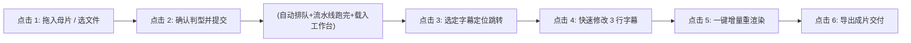

# SPEC-002: AnimeAutoSub WebUI 界面交互与规格说明书

- **状态**: 提议中 / 待 PO 确认 (Proposed for Review)
- **版本**: v1.0.0
- **核心验收判据**: **全流程 $\le 6$ 次点击交付，中途 kill worker 自动断点续跑**

---

## 一、 交互设计原则与总体目标

1. **极低认知负荷 (Zero-Friction)**：
   面向翻译员与字幕组压制人员，剔除所有冗余配置。系统自动探测片源属性与推荐参数，让用户以最短操作链路完成“载入母片 $\to$ 跑通翻译 $\to$ 快速纠错 $\to$ 导出压制成片”。
2. **全流程 $\le 6$ 次点击完成交付**：
   从投片到导出成品，鼠标有效点击次数严格控制在 6 次以内。
3. **“所见即所得”严格保障 (Pixel-Perfect WYSIWYG)**：
   前端绝不通过浏览器 Canvas 或 CSS 字体私自模拟排版。所有字幕与遮罩的抽检，均由服务端通过相同 FFmpeg libass 滤镜同源渲染单帧直接输出。
4. **异常自愈可见性**：
   当后台进程被意外终止或断线，界面具备一目了然的状态感知与一键续跑能力。

---

## 二、 核心验收流：$\le 6$ 次点击操作路径 (Click-by-Click Walkthrough)



| 步骤序号 | 操作行为 | 界面响应与反馈 | 耗时与后台机制 | 点击计数 |
| :---: | :--- | :--- | :--- | :---: |
| **Step 1** | **拖入母片文件**<br>(或点击选择文件/粘贴本地路径) | 界面瞬间解析文件元数据，展示文件名、分辨率（1080p/720p）、时长、音频编码；展示缩略首帧。 | 本地毫秒级即时校验，初始化任务容器。 | **第 1 次点击** |
| **Step 2** | **点击【立即开始处理】**<br>(确认语言 ja/ko 与模式 ocr/asr) | 按钮转为运行态；页面自动切换至【实时进度看板】。SSE 驱动 5 个阶段进度条（ASR/OCR $\to$ 翻译 $\to$ 排版 $\to$ 压制）平滑走动。 | 任务进入独占 GPU 队列开始流水线处理。 | **第 2 次点击** |
| **Auto** | *(全自动流转，0 点击)* | 全部 Stage 执行完毕后，界面**自动无缝展开【双语对照工作台】**，播放器载入成片，右侧装配全部字幕条目。 | 自动化跳转，无需多余确认弹框。 | **0 点击** |
| **Step 3** | **点击字幕列表第 N 行** | 播放器立即 Seek 精确跳转到该字幕起止时间点，并自动拉取**服务端同源单帧对比图**，高清呈现遮罩贴合度与排版。 | 触发 HTTP 206 视频跳转与单帧同源渲染接口。 | **第 3 次点击** |
| **Step 4** | **点击编辑框并修正 3 行对白**<br>(如将人名修正为标准译名) | 输入框聚焦，修改后失去焦点自动暂存或按 `Ctrl+S`。修改行高亮标注为“待重渲染”状态。 | 本地内存暂存，提交至 `PUT /subtitles`。 | **第 4 次点击** |
| **Step 5** | **点击【更新渲染】按钮** | 按钮呈现加载动画；进度条秒级完成（约 3~8 秒）。成片播放器与同源帧自动刷新，显示修改后的最新压制画面。 | **增量跳过** OCR 与翻译，仅重新执行 `layout_ass` + `burn_subtitles`。 | **第 5 次点击** |
| **Step 6** | **点击【导出成片】按钮** | 弹出系统文件保存对话框（或直接在 Windows 资源管理器中高亮打开成片文件 `output.mp4`）。 | 任务交付结项，操作闭环完成。 | **第 6 次点击** |

---

## 三、 页面架构与线框布局 (Wireframe Layout)

WebUI 采用极简双栏工作台布局，分为 **顶部状态栏 (TopBar)**、**主体媒体视口与对比器 (Left Main)**、**字幕时间轴工作台 (Right Panel)** 以及 **底栏操作区 (BottomBar)**：

```
+---------------------------------------------------------------------------------------------------------+
| [LOGO] AnimeAutoSub WebUI   | 片源: ko_1080p.mp4 (1920x1080) | GPU: RTX 4060 (6.0G/8.2G 73%) | [任务列表] |
+---------------------------------------------------------------------------------------------------------+
|                                                   |                                                     |
|  [ 左栏：视频播放器与同源帧对比视口 ]               |  [ 右栏：双语字幕审阅与编辑工作台 ]                 |
|                                                   |                                                     |
|  +---------------------------------------------+  |  阶段指示灯: [OCR ✓] [翻译 ✓] [排版 ✓] [成片压制 ✓] |
|  |                                             |  |                                                     |
|  |                                             |  |  [ 搜索过滤: 全部 / 低置信度 / 已修改 ]            |
|  |               HTML5 原生播放器              |  |  -------------------------------------------------  |
|  |        (支持 HTTP 206 随意拖拽进度条)       |  |  #06 [00:21.70 -> 00:24.46] 置信度: 96%             |
|  |                                             |  |  原文: 민수 형, 오늘 저녁에 시간 있어?             |
|  |                                             |  |  译文: [ 敏秀哥，今天晚上有空吗？                 ] |
|  +---------------------------------------------+  |  -------------------------------------------------  |
|  控制条: [▶ 播放] [00:22.15 / 01:44.29] [音量]     |  #07 [00:26.80 -> 00:29.98] 置信度: 98%             |
|                                                   |  原文: 지훈 오빠, 나 이 영화 보고 싶어.            |
|  [模式切换: 视频播放模式 | 服务端 1:1 单帧对比模式] |  译文: [ 志勋哥，我想看这部电影。                 ] |
|                                                   |  -------------------------------------------------  |
|  +---------------------------------------------+  |  #08 [00:32.14 -> 00:34.94] 置信度: 95%             |
|  | 服务端同源渲染单帧 (libass 压制帧)          |  |  原文: 수진 누나, 이번 주말에 약속 있어?           |
|  | [ 遮罩安全区 14.7% | 字体贴合无黑边残留 ]  |  |  译文: [ 秀珍姐，这个周末有约吗？                 ] |
|  +---------------------------------------------+  |                                                     |
|                                                   |                                                     |
+---------------------------------------------------------------------------------------------------------+
| [状态]: 运行完毕，耗时 46.2s | 修改项: 1 行未渲染 | [ ↺ 一键重渲染 (秒级) ]      [ ⬇ 导出压制成片 (MP4) ] |
+---------------------------------------------------------------------------------------------------------+
```

---

## 四、 核心功能模块规格与交互细节

### 1. 顶部全局状态栏 (TopBar)
- **显存与硬件监控仪表盘**：
  - 实时读取 `GET /api/system/gpu`；
  - 动态显示：显卡型号（RTX 4060）、显存占用百分比进度条（如 `6.0 GB / 8.0 GB (73%)`）；
  - 队列状态标识：当有后台任务正在占用 GPU 推理时，亮起黄色锁定警示灯并显示排队计数；空闲时为绿色就绪灯。

### 2. 媒体播放与同源对比器 (Left Main)
- **原生 HTML5 播放器**：
  - 绑定 `/api/tasks/{task_id}/video?type=output`；
  - 借由后端的 HTTP 206 Partial Content 支持，用户拖拽进度条时即时跳转，杜绝黑屏缓冲。
- **服务端 1:1 单帧对比检查器 (Toggle Mode)**：
  - 用户在审阅复杂遮罩（如双行字幕、文字贴近画面边缘）时，可一键切换为“同源对比模式”；
  - 提供滑块（Split Slider）或快捷键 `Space` 切换：
    - **左侧**：原始输入帧（纯母片无字幕）；
    - **右侧**：服务端单帧渲染输出（遮罩几何+最终中文 ASS 字幕）；
  - 直观验证是否有原日文/韩文漏出、中文字体是否被画面裁切。

### 3. 双语字幕编辑工作台 (Right Panel)
- **卡片式条目展示**：
  - 每行显示：序号、时间区间 `[Start -> End]`、原语言转写文本（OCR/ASR 产出）、中文译文编辑文本框；
  - 置信度标记：
    - 正常（绿色置信度，$\ge 85\%$）；
    - 风险预警（黄色高亮，$< 75\%$ 或触发不可分助词兜底断行项）；
    - 拒识项（红色标识，被 N5 拒识规则拦截的乱码条目）。
- **编辑体验与快捷键**：
  - 键盘 `Tab`：快速跳到下一句译文编辑框；
  - 键盘 `Ctrl + S`：快速暂存当前修改；
  - 键盘 `Ctrl + Enter`：直接触发一键重渲染。

### 4. 断点续跑与异常恢复 UI (Crash Recovery UX)
- **场景**：用户在运行到一半时关闭了浏览器，或机器发生异常断电/Worker 被杀。
- **UI 响应**：
  - 当用户再次打开网页时，首页【任务列表】检测到存在未闭环的 `work_tasks/<task_id>/` 目录；
  - 卡片呈现黄色警告徽章：**【检测到意外中断的任务：韩语测试片】**，同时标注已完成阶段（如 `[OCR 提取: 100% 完成] [翻译: 45% 中断]`）；
  - 卡片仅有一个主按钮：**【一键恢复续跑】**；
  - 点击后，后台凭借 `manifest.json` 与三元组哈希直接秒级跳过 OCR 阶段，直接恢复翻译与压制，彻底消除用户对“重跑浪费半小时”的焦虑。
